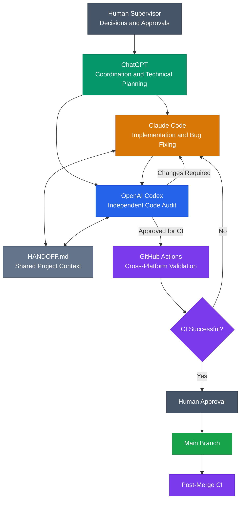
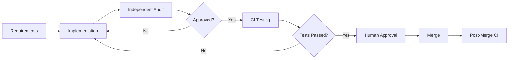
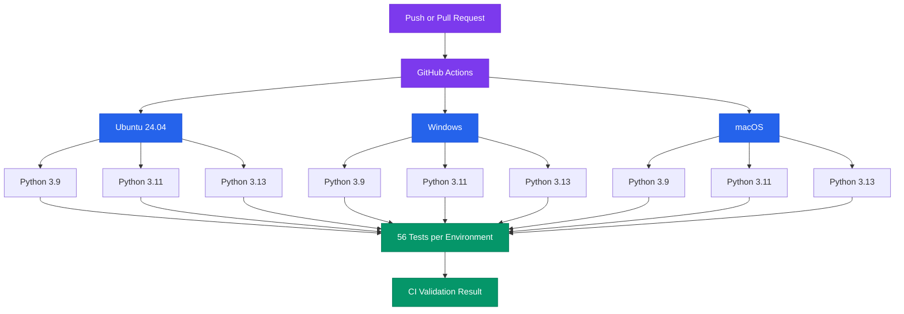
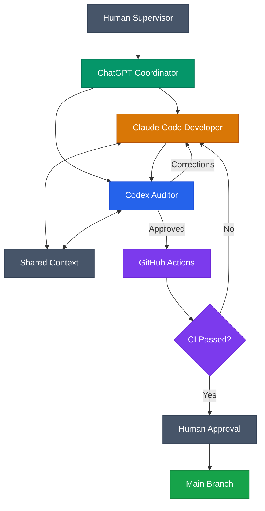

<div align="center">

# AI-Test

### Multi-Agent AI Software Engineering

**A cross-platform IPv4/IPv6 validator developed through
supervised multi-agent AI collaboration.**


**Built with AI. Audited independently. Validated automatically.
Supervised by a human.**

</div>

---

## Table of Contents

- [Project Overview](#project-overview)
- [Project Results](#project-results)
- [Multi-Agent AI Architecture](#multi-agent-ai-architecture)
- [Roles and Responsibilities](#roles-and-responsibilities)
- [Engineering Workflow](#engineering-workflow)
- [Technology Stack](#technology-stack)
- [Technical Features](#technical-features)
- [Requirements](#requirements)
- [Installation](#installation)
- [Command-Line Usage](#command-line-usage)
- [Library Usage](#library-usage)
- [Validation Rules](#validation-rules)
- [Testing and Continuous Integration](#testing-and-continuous-integration)
- [Technical Case Study](#technical-case-study-windows-compatibility)
- [Project Structure](#project-structure)
- [Development Milestones](#development-milestones)
- [Lessons Learned](#lessons-learned)
- [Known Limitations](#known-limitations)
- [Future Roadmap](#future-roadmap)
- [Project Documentation](#project-documentation)
- [Author](#author)
- [Acknowledgments](#acknowledgments)

---

## Project Overview

AI-Test is an experimental software engineering project exploring
how multiple artificial intelligence agents can collaborate under
human supervision to develop reliable, maintainable, and verifiable
software.

The technical implementation is a lightweight, dependency-free
Python tool for validating IPv4 and IPv6 addresses, usable both
as a Python library and from the command line.

Beyond IP address validation, the project serves as a proof of
concept for a structured multi-agent software engineering
methodology combining:

- AI-assisted software development
- Independent AI code auditing
- Human supervision and decision-making
- Automated regression testing
- Cross-platform continuous integration
- Shared project documentation
- Git-based traceability
- Controlled software integration

The objective is to investigate how specialized AI agents,
independent verification, and automated testing can complement
traditional software engineering practices.

---

## Project Results

| Metric | Result |
|---|---|
| Independent AI audit cycles | 9 |
| Automated unit tests | 56 |
| Validated CI environments | 9/9 |
| Successful test executions in audited CI | 504 |
| Supported operating systems | Windows, Linux, macOS |
| Tested Python versions | 3.9, 3.11, 3.13 |
| Third-party runtime dependencies | 0 |
| Unresolved blocking issues at merge | 0 |
| Pull request integration | Successful |
| Post-merge CI validation | Successful |
| Project status | Completed |

The final implementation was successfully merged into the
`main` branch following independent audits, cross-platform
testing, and human approval.

[View Final CI Results](https://github.com/Djamel1997/AI-Test/actions/runs/45316863179)

---

## Multi-Agent AI Architecture

The project follows a separation-of-responsibilities architecture,
where development, auditing, coordination, validation, and
decision-making are assigned to distinct participants.



### Architectural Principles

- Separation of implementation and verification
- Independent review of AI-generated code
- Shared and persistent project context
- Evidence-based technical decisions
- Automated validation before integration
- Human approval for critical operations
- Reproducible development history

Communication between AI agents is currently human-mediated,
using structured prompts and shared documentation.

The architecture represents a supervised multi-agent workflow,
rather than a fully autonomous multi-agent system.

---

## Roles and Responsibilities

| Participant | Role | Responsibilities |
|---|---|---|
| Human Supervisor | Project Owner | Requirements, decisions, approvals, and integration |
| ChatGPT | Project Coordinator | Technical planning, task delegation, coordination, and supervision |
| Claude Code | Software Developer | Implementation, debugging, corrections, and regression tests |
| OpenAI Codex | Independent Auditor | Code review, edge-case analysis, and technical verification |
| GitHub Actions | CI Validator | Automated cross-platform execution and validation |
| HANDOFF.md | Shared Context | Project status, decisions, audit findings, and known limitations |

### Shared Project Context

The `HANDOFF.md` file acts as a shared documentation layer
between the development and auditing agents.

It maintains:

- Current project status
- Technical decisions
- Implementation progress
- Audit findings
- Test results
- Known limitations
- Pending tasks
- Integration requirements

This approach reduces context loss between development sessions
and provides a persistent record of engineering decisions.

---

## Engineering Workflow



The development process follows a controlled engineering
workflow:

1. Define requirements and acceptance criteria.
2. Assign implementation tasks to Claude Code.
3. Perform independent code audits using Codex.
4. Identify implementation defects and edge cases.
5. Apply corrections and introduce regression tests.
6. Update the shared project documentation.
7. Execute local automated tests.
8. Validate the implementation through GitHub Actions.
9. Obtain human approval before integration.
10. Merge the approved implementation into `main`.
11. Verify the final implementation through post-merge CI.

No AI agent independently authorizes the final integration.
Critical decisions remain under human supervision.

---

## Technology Stack

<div align="center">


</div>

| Technology | Purpose |
|---|---|
| Python | Core application development |
| ipaddress | IPv4 and IPv6 address parsing |
| argparse | Command-line interface |
| unittest | Automated unit and regression testing |
| ctypes | Native Windows pipe-state detection |
| Git | Version control and traceability |
| GitHub | Repository hosting and pull requests |
| GitHub Actions | Cross-platform continuous integration |
| Markdown | Shared documentation |
| Mermaid | Architecture and workflow visualization |
| VS Code | Development environment |

---

## Technical Features

### IP Address Validation

- IPv4 address validation
- IPv6 address validation
- IPv6 compressed address support
- Embedded IPv4 addresses within IPv6
- IPv6 zone identifier validation
- Leading-zero detection
- Invalid address detection
- Strict input validation
- CIDR notation rejection

### Command-Line Interface

- Multiple address arguments
- Standard input processing
- Pipeline support
- Quiet mode
- Consistent exit-code handling
- Control-character escaping
- Broken-pipe handling
- Buffered and unbuffered output handling
- LF and CRLF input handling

### Software Engineering

- Public Python library API
- Zero third-party runtime dependencies
- Windows, Linux, and macOS compatibility
- Automated regression testing
- Independent code auditing
- Continuous integration

---

## Requirements

- Python 3.9 or later
- Git, if cloning the repository
- No third-party dependencies

The implementation uses Python's standard library.

The following Python versions are explicitly validated
through continuous integration:

- Python 3.9
- Python 3.11
- Python 3.13

Other Python versions are outside the current CI test matrix.

---

## Installation

Clone the repository:

```bash
git clone https://github.com/Djamel1997/AI-Test.git
cd AI-Test
```

Optionally, create an isolated Python environment.

### Linux and macOS

```bash
python3 -m venv .venv
source .venv/bin/activate
```

### Windows PowerShell

```powershell
python -m venv .venv
.\.venv\Scripts\Activate.ps1
```

No additional Python packages need to be installed.

Run the examples from the checkout directory.
No configuration or environment variables are required.

---

## Command-Line Usage

### Display Help

```bash
python3 -m ip_validator --help
```

### Validate Multiple IP Addresses

```bash
python3 -m ip_validator 192.168.1.1 2001:db8::1 999.1.1.1
```

Expected output:

```text
VALID    IPv4  192.168.1.1
VALID    IPv6  2001:db8::1
INVALID        999.1.1.1  (Octet 999 (> 255) not permitted in '999.1.1.1')
```

### Validate an IPv4 Address

```bash
python3 -m ip_validator 192.0.2.1
```

### Validate an IPv6 Address

```bash
python3 -m ip_validator 2001:db8::1
```

### Validate an IPv6 Address with a Zone Identifier

```bash
python3 -m ip_validator fe80::1%eth0
```

### Validate Addresses from Standard Input

With no address arguments, the CLI reads standard input
one line at a time and prints each result as it processes
the line.

```bash
cat addresses.txt | python3 -m ip_validator
```

On Windows PowerShell:

```powershell
Get-Content addresses.txt | python -m ip_validator
```

Exactly one trailing line separator (LF or CRLF) is removed
from each line.

Any other character, including an extra carriage return
(`::1\r\r\n`) or a final lone `\r`, is kept and validated,
so the line is reported as invalid.

### Validate Values Starting with a Hyphen

Use `--` before a value that starts with `-` to pass it
to the validator:

```bash
python3 -m ip_validator -- -1.2.3.4
```

### Quiet Mode

Use `-q` or `--quiet` to suppress validation results.

```bash
python3 -m ip_validator --quiet 192.168.1.1
```

Argument errors still go to standard error.

The CLI escapes control characters and other non-printable
characters in displayed addresses and error messages.

### Exit Codes

| Exit Code | Meaning |
|---|---|
| `0` | All supplied addresses are valid, or standard input is empty. |
| `1` | At least one address is invalid. A blank input line counts as an invalid address. |
| `2` | Command-line argument error. |
| `141` | Standard output was closed early (broken pipe), including while printing `--help`. Remaining output is discarded silently. |

For example, a broken pipe may occur when using:

```bash
python3 -m ip_validator < addresses.txt | head -n 1
```

Exit code `141` is the status of the Python process.
The status of a whole shell pipeline depends on the shell
(usually the last command, unless `pipefail` is set).

On Windows, use `python` instead of `python3` if required
by your Python installation.

---

## Library Usage

The validator can also be imported directly into Python
applications.

```python
from ip_validator import (
    is_valid_ipv4,
    is_valid_ipv6,
    is_valid_ip,
    validate_ip,
)

is_valid_ipv4("10.0.0.1")       # True
is_valid_ipv6("fe80::1%eth0")   # True
is_valid_ip("not-an-ip")        # False

result = validate_ip("192.168.01.1")

result.is_valid  # False
result.version   # None
result.reason    # 'IPv4 octets must not have leading zeros'
```

### Public API

| Function | Description |
|---|---|
| `is_valid_ipv4(address)` | Checks whether an input is a valid IPv4 address |
| `is_valid_ipv6(address)` | Checks whether an input is a valid IPv6 address |
| `is_valid_ip(address)` | Checks whether an input is a valid IPv4 or IPv6 address |
| `validate_ip(address)` | Returns a structured validation result |

### Validation Result

For string inputs, `result.address` contains the original
string.

For non-string inputs, it contains `"None"` for `None`
and `"<non-string input>"` for other objects.

The validation result exposes:

- `address`
- `is_valid`
- `version`
- `reason`

---

## Validation Rules

Validation is built on Python's standard `ipaddress` module,
with additional strict validation rules.

### General Rules

- Only `str` inputs are accepted.
- Integers and bytes are rejected.
- Empty strings are rejected.
- Leading and trailing whitespace are rejected.
- CIDR notation is rejected.
- Only individual IP addresses are validated.

### IPv4 Rules

IPv4 octets with leading zeros, such as `192.168.01.1`,
are rejected because they are ambiguous (octal vs. decimal).

This rule also applies to dotted IPv4 suffixes embedded
in IPv6 addresses, such as `::ffff:192.168.01.1`.

### IPv6 Rules

The following forms are supported:

- Standard IPv6 addresses
- Compressed IPv6 addresses, such as `::1`
- Embedded IPv4 addresses, such as `::ffff:1.2.3.4`
- IPv6 addresses with zone identifiers

### IPv6 Zone Identifiers

IPv6 zone IDs, such as `eth0` in `fe80::1%eth0`
and `3` in `fe80::1%3`, follow `ipaddress` syntax.

The suffix after `%`:

- Must be non-empty.
- May contain interior spaces.
- Must not contain additional `%` characters.
- Must not contain `/`.
- Must not contain control or other non-printable characters.

Rejected characters include:

- NUL
- Tab
- Newline
- Escape
- Zero-width formatting characters
- Bidirectional formatting characters

Validation treats the zone ID as an opaque string and
does not look up local network interfaces.

### Validation Examples

| Address | Result | Description |
|---|---|---|
| `192.168.1.1` | Valid | IPv4 address |
| `10.0.0.1` | Valid | IPv4 address |
| `255.255.255.255` | Valid | IPv4 address |
| `2001:db8::1` | Valid | IPv6 address |
| `::1` | Valid | IPv6 loopback address |
| `::ffff:1.2.3.4` | Valid | Embedded IPv4 |
| `fe80::1%eth0` | Valid | IPv6 with zone ID |
| `fe80::1%3` | Valid | IPv6 with numeric zone ID |
| `999.1.1.1` | Invalid | IPv4 octet exceeds 255 |
| `192.168.01.1` | Invalid | Leading zero |
| `::ffff:192.168.01.1` | Invalid | Embedded IPv4 leading zero |
| `10.0.0.0/8` | Invalid | CIDR notation |
| `2001:db8::/32` | Invalid | CIDR notation |
| `fe80::1%` | Invalid | Empty zone identifier |
| `not-an-ip` | Invalid | Invalid address format |

---

## Testing and Continuous Integration

The project includes 56 automated tests covering:

- IPv4 validation
- IPv6 validation
- Invalid input handling
- Public library API
- IPv6 zone identifiers
- Command-line argument processing
- Standard input processing
- Exit-code behavior
- Control-character escaping
- CR and CRLF handling
- Broken stdout pipes
- Closed stderr behavior
- Buffered and unbuffered output
- Native Windows pipe-state detection
- Platform-specific regression scenarios

### Run the Complete Test Suite

```bash
python3 -m unittest discover -s tests -v
```

For a shorter output:

```bash
python3 -m unittest discover -s tests -q
```

### Continuous Integration Matrix

GitHub Actions automatically validates the implementation
across three operating systems and three Python versions.

| Operating System | Python 3.9 | Python 3.11 | Python 3.13 |
|---|:---:|:---:|:---:|
| Ubuntu 24.04 | PASS | PASS | PASS |
| Windows | PASS | PASS | PASS |
| macOS | PASS | PASS | PASS |

**Validated environments: 9/9**

**Automated tests per environment: 56**

**Successful test executions in the audited CI run: 504**

The workflow is triggered by:

- Pushes to the `main` branch
- Pull requests targeting the `main` branch

### CI Architecture



[View GitHub Actions Workflows](https://github.com/Djamel1997/AI-Test/actions)

---

## Technical Case Study: Windows Compatibility

One of the most significant engineering challenges encountered
during the project involved closed-pipe behavior on Windows.

Although the implementation passed local macOS tests, the
initial cross-platform CI revealed Windows-specific failures.

### Initial CI Results

| Platform | Successful Jobs | Failed Jobs |
|---|:---:|:---:|
| Ubuntu | 3 | 0 |
| macOS | 3 | 0 |
| Windows | 0 | 3 |
| Total | 6 | 3 |

The failures highlighted differences between Windows and POSIX
behavior when writing to closed pipes.

### Investigation

The development and auditing agents investigated:

- `BrokenPipeError` handling
- Windows `EINVAL` behavior
- Buffered and unbuffered output
- Standard output and standard error
- Python `argparse` exception handling
- Native Windows pipe-state detection
- Preservation of unrelated I/O errors
- Python version-specific behavior

An initial correction based on Windows error behavior was
rejected during independent auditing because it could
incorrectly classify unrelated errors as broken pipes.

### Resolution

The final implementation introduced targeted Windows
pipe-state detection using Python's `ctypes` module
and the native `NtQueryInformationFile` function.

The correction distinguishes between pipes with an open
reader and pipes whose reader has closed.

Ambiguous or unrelated errors retain their original behavior.

Additional regression tests verify:

- Native closed-pipe detection
- Correct handling of open pipes
- Preservation of unrelated `EINVAL` errors
- Consistent CLI behavior across tested Python versions

### Final CI Results

| Platform | Initial CI | Corrected CI |
|---|:---:|:---:|
| Ubuntu | 3/3 | 3/3 |
| macOS | 3/3 | 3/3 |
| Windows | 0/3 | 3/3 |
| Overall | 6/9 | 9/9 |

### Engineering Outcome

The Windows compatibility issue demonstrates the importance
of combining independent AI reviews with real execution
environments.

Successful local tests and AI-generated assessments alone
were insufficient to establish cross-platform compatibility.

The combination of independent auditing, regression testing,
native Windows execution, and human-controlled integration
provided stronger evidence of correctness.

### CI History

| Stage | Result |
|---|---|
| Initial cross-platform CI | 6/9 successful |
| Windows compatibility correction | 9/9 successful |
| Final documentation CI | 9/9 successful |
| Post-merge CI on main | 9/9 successful |

- [Initial CI Run](https://github.com/Djamel1997/AI-Test/actions/runs/45311526668)
- [Corrected CI Run](https://github.com/Djamel1997/AI-Test/actions/runs/45314418221)
- [Final Post-Merge CI](https://github.com/Djamel1997/AI-Test/actions/runs/45316863179)

---

## Project Structure

```text
AI-Test/
│
├── .github/
│   └── workflows/
│       └── tests.yml          # Cross-platform CI workflow
│
├── ip_validator/
│   ├── __init__.py            # Public Python API
│   ├── __main__.py            # Command-line interface
│   └── validator.py           # IP validation logic
│
├── tests/
│   └── test_validator.py      # Unit and regression tests
│
├── HANDOFF.md                 # Shared AI collaboration context
└── README.md                  # Project documentation
```

---

## Development Milestones

| Milestone | Status |
|---|---|
| Initial IPv4/IPv6 validator | Completed |
| Public Python library API | Completed |
| Shared AI collaboration workflow | Completed |
| IP validation improvements | Completed |
| CLI edge-case corrections | Completed |
| Independent code auditing | Completed |
| Cross-platform CI implementation | Completed |
| Windows compatibility investigation | Completed |
| Native Windows pipe-state detection | Completed |
| Regression test expansion | Completed |
| Final documentation audit | Completed |
| Pull request integration | Completed |
| Post-merge CI validation | Completed |
| Development branch cleanup | Completed |

### Integration History

| Commit | Description |
|---|---|
| `9ea276a` | Initial release of IPv4 and IPv6 validator |
| `ab73af1` | Add shared AI collaboration workflow |
| `8600de8` | Fix IP validation and CLI edge cases |
| `84d6d29` | Fix CLI compatibility and add cross-platform CI |
| `daeebe8` | Fix Windows closed pipe detection |
| `4b6e51f` | Finalize documentation and cross-platform validation |
| `80612f0` | Merge pull request #1 into main |

The development history is preserved through Git commits,
pull requests, and continuous integration records.

---

## Lessons Learned

### Strengths

- Separation of development and auditing responsibilities
- Improved detection of implementation defects
- Independent verification of technical decisions
- Cross-platform validation through automated testing
- Reproducible development and review processes
- Transparent decision-making through Git history
- Persistent shared project context
- Human control over critical operations

### Operational Challenges

| Observed Challenge | Potential Improvement |
|---|---|
| Manual communication between agents | Automated agent-to-agent communication |
| Multiple audit and correction cycles | Targeted differential audits |
| Increasing documentation size | Structured shared memory |
| Repeated context transmission | Incremental context updates |
| Token consumption | Context and execution-cost optimization |
| Manual task coordination | Central orchestration engine |
| Repeated human approvals | Risk-based approval mechanisms |

### Key Takeaway

AI agents can complement each other when assigned distinct
responsibilities within a controlled engineering workflow.

However, independent AI approval does not replace empirical
testing, and successful testing does not guarantee the absence
of all possible defects.

Human supervision, automated verification, and reproducible
engineering practices remain essential.

This project demonstrates a successful supervised collaboration
experiment, not a controlled benchmark comparing AI models.

---

## Known Limitations

### Technical Limitations

- Python 3.14 is outside the current validation scope.
- Python versions not included in the CI matrix are not
  explicitly validated.
- Windows compatibility testing covers the pipe scenarios
  implemented using `os.pipe` and `subprocess`.
- Interactive terminal behavior and pipelines specific to
  other shells are outside the current test coverage.
- Some CLI behavior depends on Python `argparse` internals,
  which may change in future Python releases.
- Native Windows pipe-state detection depends on Windows
  system behavior.
- IPv6 zone identifiers are validated syntactically and are
  not checked against actual network interfaces.
- The tool validates individual IP addresses, not networks
  or CIDR ranges.
- The tool does not verify network reachability.

### Multi-Agent Limitations

- Communication between AI agents is human-mediated.
- Task distribution is not fully automated.
- There is no autonomous orchestration engine.
- Shared context is maintained through Markdown documentation.
- AI audits may contain omissions or incorrect conclusions.
- The experiment does not establish that multi-agent development
  is always more efficient than single-agent development.

Detailed technical findings and remaining limitations are
documented in `HANDOFF.md`.

---

## Future Roadmap

The next phase will explore the transition from human-mediated
AI collaboration to automated multi-agent orchestration.

### Phase 1 — Supervised Multi-Agent Collaboration

- [x] Functional software engineering proof of concept
- [x] Separation of development and audit responsibilities
- [x] Independent AI code auditing
- [x] Shared project documentation
- [x] Automated regression testing
- [x] Cross-platform continuous integration
- [x] Human-controlled integration
- [x] Post-merge validation

### Phase 2 — Automated Multi-Agent Orchestration

- [ ] Automated agent-to-agent communication
- [ ] Central orchestration engine
- [ ] Structured shared memory
- [ ] Automated task distribution
- [ ] Automated audit triggering
- [ ] Automated CI feedback processing
- [ ] Differential context transmission
- [ ] Risk-based human approval mechanisms
- [ ] Token and execution-cost monitoring
- [ ] Agent performance evaluation
- [ ] Reusable multi-agent engineering framework

### Proposed Future Architecture



This architecture is a proposed future direction and is
not implemented in the current repository.

---

## Applications

This project combines engineering concepts relevant to:

- Network Engineering
- Telecommunications
- Cybersecurity
- IP Address Validation
- Network Data Processing
- Software Engineering
- DevOps and CI/CD
- Infrastructure Automation
- Artificial Intelligence
- Multi-Agent Systems
- Software Quality Assurance

The validator can serve as a reusable component for network
data validation, log processing, and other applications
requiring syntactically valid IP addresses.

---

## Project Documentation

Detailed implementation decisions, audit findings, test results,
known limitations, and development history are available through:

| Resource | Description |
|---|---|
| [HANDOFF.md](HANDOFF.md) | Shared project context and technical documentation |
| [Pull Request #1](https://github.com/Djamel1997/AI-Test/pull/1) | Development and integration history |
| [GitHub Actions](https://github.com/Djamel1997/AI-Test/actions) | Continuous integration results |
| [Final CI Validation](https://github.com/Djamel1997/AI-Test/actions/runs/45316863179) | Successful post-merge validation |
| [Commit History](https://github.com/Djamel1997/AI-Test/commits/main/) | Complete development history |

---

## Author

<div align="center">

### Djamel-Eddine Ladjine

**M.Eng. in Telecommunications Network Engineering**

École de technologie supérieure (ÉTS), Montréal, Canada

Network Engineering | Telecommunications | Cybersecurity |
Cloud-Native Technologies | Automation | AI Engineering

[](https://github.com/Djamel1997)
[](https://djamel-ladjine.me)

</div>

---

## Acknowledgments

This project was developed through a supervised collaborative
software engineering experiment involving:

- **OpenAI ChatGPT** — Project coordination and technical planning
- **Anthropic Claude Code** — Software implementation and corrections
- **OpenAI Codex** — Independent code auditing and verification
- **GitHub Actions** — Automated cross-platform validation

All critical decisions, approvals, and repository integration
operations were supervised by the human project owner.

The AI tools were used as engineering assistants and do not
imply endorsement or affiliation with their respective providers.

---

<div align="center">

### Built with AI.
### Audited independently.
### Validated automatically.
### Supervised by a human.

*Exploring the future of collaborative software engineering.*


</div>
